<div align="center">
  

  # 🛡️ Aegis Vault

  ### **100% Local, Two-Layer Zero-Knowledge Password Manager.**
  *Fast, private, and cloud-free desktop vault powered by Tauri 2 & Web Crypto API*

  <p align="center">
    <a href="README.md"><strong>🇬🇧 English</strong></a> &bull;
    <a href="README.tr.md"><strong>🇹🇷 Türkçe</strong></a>
  </p>

  <p align="center">
    <a href="https://github.com/DrXendria/Aegis/releases"></a>
    <a href="https://tauri.app/"></a>
    <a href="https://react.dev/"></a>
    <a href="https://www.typescriptlang.org/"></a>
    <a href="https://opensource.org/licenses/MIT"></a>
  </p>

  <p align="center">
    <strong>🔒 AES-256-GCM</strong> &bull;
    <strong>⚡ 600,000x PBKDF2</strong> &bull;
    <strong>💾 100% Local Vault</strong> &bull;
    <strong>🔄 Auto 2-Week Encrypted Backups</strong> &bull;
    <strong>🌍 25 Languages</strong>
  </p>

  <p align="center">
    <a href="#-quick-download--installation"><strong>Download</strong></a> &bull;
    <a href="#️-local-zero-knowledge-security-architecture"><strong>Security Architecture</strong></a> &bull;
    <a href="#-25-supported-languages-100-localized"><strong>Languages</strong></a> &bull;
    <a href="#-developer-guide"><strong>Developer Guide</strong></a>
  </p>
</div>

---

## 🚀 Quick Download & Installation

No build tools, no `.env` files, and no cloud accounts required. Download the pre-built installer for your OS and start using Aegis immediately:

| Platform | Download Link | Package Type | Status |
| :--- | :--- | :--- | :--- |
| **🪟 Windows** | [**Aegis_0.2.0_x64-setup.exe**](https://github.com/DrXendria/Aegis/releases/download/v0.2.0/Aegis_0.2.0_x64-setup.exe) | NSIS Installer (`.exe`) | 🟢 Stable |
| **🪟 Windows (MSI)** | [**Aegis_0.2.0_x64_en-US.msi**](https://github.com/DrXendria/Aegis/releases/download/v0.2.0/Aegis_0.2.0_x64_en-US.msi) | MSI Package (`.msi`) | 🟢 Stable |
| **🍎 macOS (Apple Silicon)** | [**Aegis_0.2.0_aarch64.dmg**](https://github.com/DrXendria/Aegis/releases/download/v0.2.0/Aegis_0.2.0_aarch64.dmg) | Disk Image (`.dmg`) | 🟢 Stable |
| **🐧 Linux (Universal)** | [**Aegis_0.2.0_amd64.AppImage**](https://github.com/DrXendria/Aegis/releases/download/v0.2.0/Aegis_0.2.0_amd64.AppImage) | Portable (`.AppImage`) | 🟢 Stable |
| **🐧 Linux (Debian / Ubuntu)** | [**Aegis_0.2.0_amd64.deb**](https://github.com/DrXendria/Aegis/releases/download/v0.2.0/Aegis_0.2.0_amd64.deb) | Debian Package (`.deb`) | 🟢 Stable |
| **🐧 Linux (Fedora / RHEL)** | [**Aegis-0.2.0-1.x86_64.rpm**](https://github.com/DrXendria/Aegis/releases/download/v0.2.0/Aegis-0.2.0-1.x86_64.rpm) | RPM Package (`.rpm`) | 🟢 Stable |

> [!TIP]
> Visit the GitHub [**Releases**](https://github.com/DrXendria/Aegis/releases) page for the latest builds and full changelogs.

---

## 🛡️ Local Zero-Knowledge Security Architecture

Aegis v0.2.0 is **100% local-only** — there is **no cloud database, no external server, and zero third-party telemetry**. Your passwords, titles, usernames, credit cards, and notes never leave your machine.

```mermaid
sequenceDiagram
    autonumber
    actor User as 👤 User
    participant App as 💻 Aegis Desktop (Tauri + React)
    participant Crypto as 🔐 Web Crypto API (PBKDF2 + AES-256-GCM)
    participant Disk as 💾 Local Disk (.aegis + .bak + Backups)

    User->>App: Layer 1 — Email + Account Password
    App->>Crypto: PBKDF2-SHA256 (600,000 rounds + random salt)
    Crypto-->>App: Constant-time hash verification against accounts.json

    User->>App: Layer 2 — Master Password
    App->>Crypto: PBKDF2-SHA256 (600,000 rounds) → 256-bit AES-GCM Key
    App->>Disk: Read vault_<id>.aegis (fallback to .bak if corrupted)
    App->>Crypto: Verify keyCheck sentinel & decrypt entries in memory
    Crypto-->>App: Decrypted vault entries (passwords stay masked until revealed)

    rect rgb(15, 23, 42)
        Note right of App: Crash-Safe Atomic Save
        App->>Crypto: Encrypt full entry payload (title, username, secret, metadata) + 96-bit random IV
        Crypto-->>App: Encrypted blob { v: 2, ciphertext, iv, updatedAt }
        App->>Disk: Copy current → .bak, write .tmp → atomic rename to vault_<id>.aegis
    end

    Note over Disk: Every 14 days, an encrypted snapshot is automatically saved<br/>to Documents/Aegis-Backups/aegis-auto-backup-YYYY-MM-DD.json
```



### 🔒 Cryptographic & Data-Safety Guarantees
1. **Two-Layer Local Protection:**
   - **Layer 1 (Account Login):** Email + Account Password verified locally using **PBKDF2-SHA256 (600,000 iterations + random 128-bit salt)**. Supports multiple isolated local profiles on the same computer.
   - **Layer 2 (Vault Encryption):** Separate **Master Password** derives a 256-bit **AES-GCM** key that encrypts every entry (including titles, usernames, passwords, card details, and notes) with a unique 96-bit random IV.
2. **Instant Master Password Verification:** A `keyCheck` encrypted sentinel rejects an incorrect Master Password immediately at unlock instead of opening an empty vault.
3. **Crash-Safe Atomic Writes:** Every save copies the previous healthy vault to `.bak`, writes the new file to `.tmp`, and atomically renames it into place.
4. **Automatic 2-Week Encrypted Disk Backups:** Every 14 days (and on-demand), Aegis writes an AES-256-GCM encrypted backup file to `Documents/Aegis-Backups/`.
5. **Clipboard Auto-Purge:** Copied passwords are automatically cleared from your clipboard after 30 seconds.

---

## ✨ Key Features

- **🔒 100% Local & Cloud-Free:** Zero cloud exposure, zero expired rules, zero API keys. Want multi-device sync? Simply sync your encrypted `.aegis` vault file or backups via Syncthing, Nextcloud, Google Drive, or USB.
- **🛡️ Two-Layer Local Security:** Email + PBKDF2-hashed account login followed by Master Password AES-256-GCM vault unlock.
- **💾 Automatic 2-Week Encrypted Disk Backups:** Scheduled encrypted backups in `Documents/Aegis-Backups/` plus one-click restore and manual backup controls.
- **⚠️ 90+ Day Password Health Alerts:** Automatic warnings and badges for passwords older than 90 days.
- **📥 1-Click Import & Export:** Import from Google Chrome (`.csv`), Bitwarden (`.csv`/`.json`), LastPass (`.csv`), or Aegis Encrypted v2 backups (`.json`).
- **⚡ Fast Search & Generator:** Instant filtering, one-click copy, built-in strong password generator, and 30-second clipboard auto-clear.
- **💳 Credit Cards & Secure Notes:** Masked card numbers, hidden CVV, and encrypted secure notes.
- **💱 Multi-Currency Subscription Tracker:** Track recurring subscriptions across 18 currencies with automatic total calculation.
- **🏷️ Custom Categories & Filters:** Built-in and user-defined categories with instant filtering.
- **🎨 Glassmorphic UI:** Dark & Light themes with smooth micro-animations and swipe gestures.
- **🌍 25 Global Languages:** 100% localized across 25 languages.

---

## 📥 1-Click Import (Chrome, Bitwarden, LastPass, Aegis)

Migrating to Aegis takes seconds:

1. **Google Chrome:** `chrome://password-manager/settings` → *Export passwords* (`.csv`).
2. **Bitwarden:** *Settings* → *Export Vault* (`.csv` or `.json`).
3. **LastPass:** *Advanced Options* → *Export* (`.csv`).
4. **Aegis Encrypted Backup:** Any `aegis-auto-backup-YYYY-MM-DD.json` file from `Documents/Aegis-Backups/`.
5. **Import into Aegis:**
   - Open Aegis → click **Data Management** in the sidebar.
   - Click **Import Data** and select your file.
   - Entries are auto-categorized, encrypted locally with AES-256-GCM, and saved atomically to your `.aegis` vault.

---

## 🌍 25 Supported Languages (100% Localized)

| Language | Code | Language | Code | Language | Code |
| :--- | :--- | :--- | :--- | :--- | :--- |
| 🇹🇷 **Türkçe** | `tr` | 🇨🇳 **中文** | `zh` | 🇩🇰 **Dansk** | `da` |
| 🇬🇧 **English** | `en` | 🇮🇳 **हिन्दी** | `hi` | 🇳🇴 **Norsk** | `no` |
| 🇩🇪 **Deutsch** | `de` | 🇰🇷 **한국어** | `ko` | 🇸🇪 **Svenska** | `sv` |
| 🇪🇸 **Español** | `es` | 🇯🇵 **日本語** | `ja` | 🇫🇮 **Suomi** | `fi` |
| 🇫🇷 **Français** | `fr` | 🇸🇦 **العربية** | `ar` | 🇳🇱 **Nederlands** | `nl` |
| 🇮🇹 **Italiano** | `it` | 🇮🇷 **فارسی** | `fa` | 🇵🇱 **Polski** | `pl` |
| 🇵🇹 **Português** | `pt` | 🇬🇷 **Ελληνικά** | `el` | 🇮🇩 **Bahasa Indonesia** | `id` |
| 🇷🇺 **Русский** | `ru` | 🇮🇱 **עברית** | `he` | 🇺🇦 **Українська** | `uk` |
| 🇵🇭 **Filipino (Tagalog)** | `fil` | | | | |

---

## 💻 Developer Guide

No environment variables or backend setup required to run or build from source.

### Prerequisites
- **Node.js** (v18+)
- **Rust & Cargo** (for Tauri 2.0)
- **Git**

### Build & Run
```bash
# 1. Clone the repository
git clone https://github.com/DrXendria/Aegis.git
cd Aegis

# 2. Install dependencies
npm install

# 3. Start frontend dev server (Hot-Reload)
npm run dev

# 4. Run desktop app in development mode
npm run tauri dev

# 5. Build production installers (.exe, .msi, .dmg, .AppImage, .deb, .rpm)
npm run tauri build
```

Compiled installers are output to `src-tauri/target/release/bundle/`.

---

## 🛡️ Comparison

| Feature | Aegis Vault | 1Password | Bitwarden | LastPass |
| :--- | :---: | :---: | :---: | :---: |
| **Zero-Knowledge Encryption** | **✅ AES-256-GCM** | ✅ Yes | ✅ Yes | ⚠️ Closed Source |
| **100% Local / No Cloud Required** | **✅ Yes** | ❌ No | ⚠️ Self-Host Only | ❌ No |
| **PBKDF2 Iterations** | **⚡ 600,000** | 650,000 | 600,000 | 100,100 |
| **Auto Encrypted Disk Backups** | **✅ Built-in (14d)** | ❌ No | ❌ No | ❌ No |
| **Subscription & FX Tracker** | **✅ Built-in (18 FX)** | ❌ No | ❌ No | ❌ No |
| **Password Aging Alerts (90d)** | **✅ Automatic** | ⚠️ Report Only | ⚠️ Paid | ❌ No |
| **Open Source (MIT)** | **✅ 100% Open** | ❌ Closed | ✅ Open | ❌ Closed |
| **Languages** | **🌍 25** | 12 | 16 | 8 |
| **Desktop Engine** | **🚀 Tauri 2.0** | Electron (150MB+) | Electron (150MB+) | Web |
| **Price** | **🎉 Free Forever** | $35.88 / yr | $10.00 / yr | $36.00 / yr |

---

## 👨‍💻 Author & License

Built by **[DrXendria](https://github.com/DrXendria)** for users who value true local privacy, strong cryptography, and clean design.

- **License:** [MIT License](LICENSE)
- **Contributions:** Issues and Pull Requests are always welcome.

<div align="center">
  <sub>Privacy, security, and design in harmony. &copy; 2026 DrXendria</sub>
</div>
