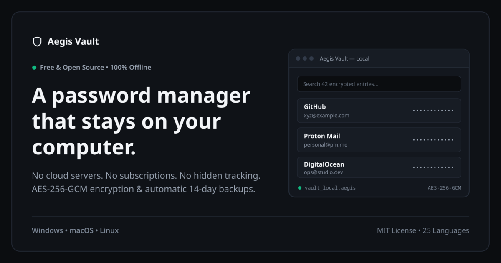

<div align="center">
  

  <h1>Aegis Vault</h1>

  <p><strong>A local-first, two-layer zero-knowledge password manager for Windows, macOS, and Linux.</strong></p>

  <p>
    <a href="https://aegis-vault-web.onrender.com">Website</a> &middot;
    <a href="https://github.com/DrXendria/Aegis/releases/latest">Releases</a> &middot;
    <a href="#installation">Installation</a> &middot;
    <a href="#security-architecture">Security</a> &middot;
    <a href="#build-from-source">Build</a>
  </p>

  <p>
    <a href="README.md"><strong>English</strong></a> &middot;
    <a href="README.tr.md">Türkçe</a>
  </p>

  <p>
    <a href="https://github.com/DrXendria/Aegis/releases/latest"></a>
    <a href="https://github.com/DrXendria/Aegis/releases"></a>
    <a href="LICENSE"></a>
    
  </p>

  <br />

  
</div>

---

## Overview

Aegis Vault is an open-source, strictly offline desktop password manager. It operates with **no cloud database, no subscription, no telemetry, and no network dependency**. Logins, payment cards, subscriptions, and secure notes are encrypted locally on disk using `AES-256-GCM` and `PBKDF2-SHA256` (600,000 iterations), backed by crash-safe atomic saves and automatic 14-day encrypted disk backups.

---

## Installation

### Package Managers

**macOS (Homebrew)**
```bash
brew install --cask drxendria/tap/aegis-vault
```

**Ubuntu / Debian / Linux Mint (APT)**
```bash
echo "deb [trusted=yes] https://drxendria.github.io/Aegis/apt ./" | sudo tee /etc/apt/sources.list.d/aegis.list
sudo apt update && sudo apt install aegis
```

**Fedora / RHEL / Rocky (DNF / YUM)**
```bash
sudo curl -fsSL https://drxendria.github.io/Aegis/rpm/aegis.repo -o /etc/yum.repos.d/aegis.repo
sudo dnf install aegis
```

**openSUSE (Zypper)**
```bash
sudo zypper addrepo -f https://drxendria.github.io/Aegis/rpm/ aegis-vault
sudo zypper install aegis
```

**Windows (Scoop)**
```powershell
scoop bucket add drxendria https://github.com/DrXendria/scoop-bucket
scoop install aegis-vault
```

**Windows (Winget — [PR #489590](https://github.com/microsoft/winget-pkgs/pull/489590) pending review)**
```powershell
winget install DrXendria.Aegis
```

### Direct Downloads (`v0.3.0`)

| Platform | Package | Download |
| :--- | :--- | :--- |
| Windows (x64) | NSIS Installer (`.exe`) | [Aegis_0.3.0_x64-setup.exe](https://github.com/DrXendria/Aegis/releases/download/v0.3.0/Aegis_0.3.0_x64-setup.exe) |
| Windows (x64) | MSI Package (`.msi`) | [Aegis_0.3.0_x64_en-US.msi](https://github.com/DrXendria/Aegis/releases/download/v0.3.0/Aegis_0.3.0_x64_en-US.msi) |
| macOS (Apple Silicon) | Disk Image (`.dmg`) | [Aegis_0.3.0_aarch64.dmg](https://github.com/DrXendria/Aegis/releases/download/v0.3.0/Aegis_0.3.0_aarch64.dmg) |
| Linux (Universal) | Portable (`.AppImage`) | [Aegis_0.3.0_amd64.AppImage](https://github.com/DrXendria/Aegis/releases/download/v0.3.0/Aegis_0.3.0_amd64.AppImage) |
| Linux (Debian / Ubuntu / Mint) | Debian Package (`.deb`) | [Aegis_0.3.0_amd64.deb](https://github.com/DrXendria/Aegis/releases/download/v0.3.0/Aegis_0.3.0_amd64.deb) |
| Linux (Fedora / RHEL / openSUSE) | RPM Package (`.rpm`) | [Aegis-0.3.0-1.x86_64.rpm](https://github.com/DrXendria/Aegis/releases/download/v0.3.0/Aegis-0.3.0-1.x86_64.rpm) |
| Browser Extension (Opera GX / Chrome / Brave / Edge / Firefox) | Manifest V3 (`.zip`) | [Aegis_v0.3.0_browser-extension.zip](https://github.com/DrXendria/Aegis/releases/download/v0.3.0/Aegis_v0.3.0_browser-extension.zip) |

> [!NOTE]
> **Unsigned binary notice:** On macOS, right-click `Aegis.app` → **Open** (or run `xattr -cr /Applications/Aegis.app`). On Windows, click **More info → Run anyway** if SmartScreen prompts on first launch.

---

## Security Architecture

Aegis Vault is 100% local. No credentials, metadata, or diagnostics ever leave your machine.

```mermaid
sequenceDiagram
    autonumber
    actor User
    participant App as Aegis Desktop
    participant Crypto as Web Crypto (PBKDF2 + AES-GCM)
    participant Disk as Local Storage (.aegis / .bak)

    User->>App: Layer 1 - Local Account Credentials
    App->>Crypto: PBKDF2-SHA256 (600,000 rounds + 128-bit salt)
    Crypto-->>App: Constant-time verification against accounts.json

    User->>App: Layer 2 - Master Password
    App->>Crypto: PBKDF2-SHA256 (600,000 rounds) -> 256-bit AES-GCM key
    App->>Disk: Read vault_<id>.aegis (auto-fallback to .bak)
    App->>Crypto: Verify keyCheck sentinel and decrypt entries in memory
    Crypto-->>App: Unlocked session (secrets masked until explicitly revealed)

    rect rgb(15, 23, 42)
        Note right of App: Crash-Safe Atomic Write
        App->>Crypto: Encrypt full entry payload + 96-bit random IV
        Crypto-->>App: { v: 2, ciphertext, iv, updatedAt }
        App->>Disk: Copy current -> .bak, write .tmp -> atomic rename
    end

    Note over Disk: Automatic encrypted backup every 14 days<br/>Documents/Aegis-Backups/aegis-auto-backup-YYYY-MM-DD.json
```



### Cryptographic Guarantees

1. **Two-Layer Isolation:** Local profile authentication (`accounts.json`, 600,000-round PBKDF2-SHA256) is separate from vault encryption (Master Password → 256-bit AES-GCM). Multiple isolated local profiles are supported on the same machine.
2. **Full-Entry Encryption:** Site titles, usernames, passwords, card numbers, CVVs, and notes are encrypted together under a unique 96-bit random IV per record.
3. **Sentinel Verification:** An encrypted `keyCheck` block validates the Master Password immediately at unlock.
4. **Atomic Persistence & Recovery:** Every mutation copies the last known-good vault to `.bak`, writes the updated payload to `.tmp`, and atomically renames it into place.
5. **Scheduled Encrypted Backups:** Every 14 days (and on-demand), Aegis writes an encrypted snapshot to `Documents/Aegis-Backups/`.
6. **Clipboard Hygiene:** Copied secrets are automatically cleared from the system clipboard after 30 seconds.

---

## Features

- **Offline by Design:** Zero cloud servers, zero API keys, zero accounts to breach. Sync across devices on your own terms via Syncthing, Nextcloud, USB, or encrypted backups.
- **Browser Extension (Opera GX / Chrome / Brave / Edge / Firefox):** 100% local Autofill and Auto-Save via a pairing-token authenticated `127.0.0.1` bridge—credentials stay in RAM only while unlocked and never touch the internet.
- **Full Local Account Management:** Change email, Layer-1 account password, Layer-2 Master Password (with atomic vault re-encryption), or permanently delete your local profile and vault.
- **One-Click Migration:** Import directly from Google Chrome (`.csv`), Bitwarden (`.csv` / `.json`), LastPass (`.csv`), or previous Aegis v2 encrypted backups (`.json`).
- **Password Health:** Built-in cryptographic password generator and automatic 90-day aging reminders.
- **Cards, Notes & Subscriptions:** Masked payment cards, encrypted notes, and recurring subscription tracking across 22 currencies with language-prioritized currency ordering and exact per-currency totals.
- **25 Languages:** Complete native localization with persistent language selection and RTL support.

---

## Supported Languages

| | | | | |
| :--- | :--- | :--- | :--- | :--- |
| English (`en`) | Türkçe (`tr`) | Deutsch (`de`) | Español (`es`) | Français (`fr`) |
| Italiano (`it`) | Português (`pt`) | Русский (`ru`) | 中文 (`zh`) | हिन्दी (`hi`) |
| 한국어 (`ko`) | 日本語 (`ja`) | العربية (`ar`) | فارسی (`fa`) | Ελληνικά (`el`) |
| עברית (`he`) | Dansk (`da`) | Norsk (`no`) | Svenska (`sv`) | Suomi (`fi`) |
| Nederlands (`nl`) | Polski (`pl`) | Bahasa Indonesia (`id`) | Українська (`uk`) | Filipino (`fil`) |

---

## Build from Source

No `.env` files or external services are required.

**Prerequisites:** Node.js 18+, Rust & Cargo, Git.

```bash
git clone https://github.com/DrXendria/Aegis.git
cd Aegis
npm install

# Development mode
npm run tauri dev

# Production installers (output: src-tauri/target/release/bundle/)
npm run tauri build
```

---

## Comparison

| Capability | Aegis Vault | 1Password | Bitwarden | LastPass |
| :--- | :---: | :---: | :---: | :---: |
| Encryption | `AES-256-GCM` | `AES-256-GCM` | `AES-256-CBC` | Closed Source |
| 100% Local / Offline | Yes | No | Self-host only | No |
| PBKDF2 Iterations | `600,000` | `650,000` | `600,000` | `100,100` |
| Automatic Local Backups | Built-in (14d) | No | No | No |
| Subscription Tracker | Built-in (22 FX) | No | No | No |
| Open Source | MIT | No | GPL-3.0 | No |
| Languages | 25 | 12 | 16 | 8 |
| Price | Free | \$35.88 / yr | \$10.00 / yr | \$36.00 / yr |

---

## License

Released under the [MIT License](LICENSE) by [DrXendria](https://github.com/DrXendria).
Issues and pull requests are welcome.
