<div align="center">
  

  # 🛡️ Aegis Vault

  ### **Dijital Hayatınızı Güvenle Koruyun ve Senkronize Edin.**
  *Next-Generation Zero-Knowledge Desktop & Web Password Manager*

  <p align="center">
    <a href="https://github.com/DrXendria/Aegis/releases"></a>
    <a href="https://tauri.app/"></a>
    <a href="https://react.dev/"></a>
    <a href="https://www.typescriptlang.org/"></a>
    <a href="https://opensource.org/licenses/MIT"></a>
  </p>

  <p align="center">
    <strong>🔒 AES-256-GCM</strong> &bull;
    <strong>⚡ 600,000x PBKDF2</strong> &bull;
    <strong>🌍 25 Küresel Dil</strong> &bull;
    <strong>📱 Mobil & Hızlı Erişim</strong> &bull;
    <strong>💳 Çoklu Para Birimli Abonelik Takibi</strong>
  </p>

  <p align="center">
    <a href="#-hızlı-indirme--kurulum-quick-download"><strong>Hemen İndir (.exe)</strong></a> &bull;
    <a href="#️-sıfır-bilgi-zero-knowledge-güvenlik-mimarisi"><strong>Güvenlik Şeması</strong></a> &bull;
    <a href="#-25-desteklenen-küresel-dil-100-yerel"><strong>Diller</strong></a> &bull;
    <a href="#-geliştirici-rehberi-development"><strong>Geliştirici Rehberi</strong></a>
  </p>
</div>

---

## 🚀 Hızlı İndirme & Kurulum (Quick Download)

Aegis'i kullanmak için kod derlemenize veya terminal açmanıza **gerek yoktur**. İşletim sisteminize uygun hazır derlenmiş masaüstü yükleyicisini indirip hemen kullanmaya başlayabilirsiniz:

| Platform | İndirme Bağlantısı | Dosya Türü | Durum |
| :--- | :--- | :--- | :--- |
| **🪟 Windows** | [**Aegis_0.1.4_x64-setup.exe**](https://github.com/DrXendria/Aegis/releases/download/v0.1.4/Aegis_0.1.4_x64-setup.exe) | Setup Yükleyici (`.exe`) | 🟢 Kararlı (Stable) |
| **🪟 Windows (MSI)** | [**Aegis_0.1.4_x64_en-US.msi**](https://github.com/DrXendria/Aegis/releases/download/v0.1.4/Aegis_0.1.4_x64_en-US.msi) | MSI Paketi (`.msi`) | 🟢 Kararlı |
| **🍎 macOS (Apple Silicon)** | [**Aegis_0.1.4_aarch64.dmg**](https://github.com/DrXendria/Aegis/releases/download/v0.1.4/Aegis_0.1.4_aarch64.dmg) | Apple Silicon (`.dmg`) | 🟢 Kararlı |
| **🐧 Linux (Evrensel)** | [**Aegis_0.1.4_amd64.AppImage**](https://github.com/DrXendria/Aegis/releases/download/v0.1.4/Aegis_0.1.4_amd64.AppImage) | Portable (`.AppImage`) | 🟢 Kararlı |
| **🐧 Linux (Debian / Ubuntu)** | [**Aegis_0.1.4_amd64.deb**](https://github.com/DrXendria/Aegis/releases/download/v0.1.4/Aegis_0.1.4_amd64.deb) | Debian Paketi (`.deb`) | 🟢 Kararlı |
| **🐧 Linux (Fedora / RHEL)** | [**Aegis-0.1.4-1.x86_64.rpm**](https://github.com/DrXendria/Aegis/releases/download/v0.1.4/Aegis-0.1.4-1.x86_64.rpm) | RPM Paketi (`.rpm`) | 🟢 Kararlı |

> [!TIP]
> En son sürümler, değişiklik günlükleri ve tüm indirme seçenekleri için GitHub [**Releases**](https://github.com/DrXendria/Aegis/releases/tag/v0.1.4) sayfasını ziyaret edebilirsiniz.

---

## 🛡️ Sıfır Bilgi (Zero-Knowledge) Güvenlik Mimarisi

Aegis, **Sıfır Bilgi (Zero-Knowledge)** prensibiyle inşa edilmiştir. Ana parolanız (Master Password) ve kasanızdaki şifreler **asla düz metin olarak bilgisayarınızdan dışarı çıkmaz**.

```mermaid
sequenceDiagram
    autonumber
    actor User as 👤 Kullanıcı
    participant Client as 💻 Aegis İstemcisi (Tarayıcı / Tauri)
    participant Crypto as 🔐 Web Crypto API (AES-256-GCM)
    participant Cloud as ☁️ Firebase Firestore

    User->>Client: Master Şifre & Kullanıcı Girişi
    Note over Client,Crypto: Cihaz İçinde (Bellekte) İşlem
    Client->>Crypto: PBKDF2 (SHA-256, 600.000 Tur) + Tuz
    Crypto-->>Client: 256-bit AES Simetrik Kripto Anahtarı
    
    rect rgb(15, 23, 42)
        Note right of Client: Kasa Kayıt & Güncelleme
        Client->>Crypto: Düz Şifre + 96-bit Rastgele IV
        Crypto-->>Client: Şifrelenmiş İkili Blok (Ciphertext)
        Client->>Cloud: YALNIZCA Şifreli Blok Kaydedilir ({ciphertext, iv})
    end

    Note over Cloud: Bulut Sunucusu YALNIZCA Anlamsız Şifreli Karakterler Görür!<br/>Asla Düz Metin Şifre veya Anahtara Erişemez.

    rect rgb(15, 23, 42)
        Note right of Client: Kasa Kilidi Açma (Senkronizasyon)
        Cloud-->>Client: Şifrelenmiş Bloklar Gelir
        Client->>Crypto: Ciphertext + Master Key ile Çöz (Decrypt)
        Crypto-->>Client: Düz Metin Şifreler Ekranda Gösterilir
        Client-->>User: Kasa Açıldı & Kullanıma Hazır
    end
```



### 🔒 Kriptografik Özellikler:
1. **Anahtar Türetme (KDF):** PBKDF2 with HMAC-SHA-256, **600,000 iterasyon** (OWASP 2026 standartlarına uygun).
2. **Simetrik Şifreleme:** AES-GCM (Galois/Counter Mode) 256-bit — hem veri gizliliği hem de bütünlük doğrulama (tamper-proof) sunar.
3. **Benzersiz IV:** Her bir parola ve kayıt için 96-bit kriptografik rastgele Initialization Vector (IV).
4. **Pano Güvenliği (Clipboard Auto-Purge):** Kopyalanan şifreler 30 saniye sonra sistem panosundan otomatik olarak temizlenir.

---

## ✨ Temel Özellikler

- **🔒 İki Kademeli Güvenlik:** İsteğe bağlı Firebase Bulut Senkronizasyonu + Asla kırılması mümkün olmayan yerel Master Şifre.
- **⚠️ 90+ Günlük Eski Şifre Bildirimi:** Uzun süredir güncellenmemiş veya unutulmuş şifreler için otomatik sağlık uyarısı ve özel rozetler (`badge-old-password`).
- **📥 1-Tıkla İçe Aktarma (Import):** Google Chrome, Bitwarden, LastPass ve Aegis yedeklerinizi tek tıkla kasanıza aktarın.
- **⚡ Hızlı Arama & Tek Tıkla Kopyalama:** Arama çubuğuyla anında hesap bulma, tek tıkla kullanıcı adı/şifre kopyalama, güvenli şifre üretici ve 30 saniye sonra otomatik pano temizleme.
- **📱 Mobil & Hızlı Erişim:** Android Otomatik Doldurma (AutoFill) mimarisi + iOS Safari ve Android Chrome için PWA desteği + Tek dokunuşla çalışan yer imi (Bookmarklet).
- **💳 Kredi Kartları & Güvenli Notlar:** CVV gizleme, kart numarası maskeleme ve özel şifreli not defteri.
- **💱 Çoklu Para Birimli Abonelik Takibi:** Netflix, Spotify, AWS gibi aboneliklerinizi TRY, USD, EUR, GBP ve 15+ para biriminde kaydedin; anlık döviz kuruyla aylık toplam giderinizi görün.
- **🏷️ Dinamik Kategori & Filtreleme:** Sosyal Medya, Eğlence, Eğitim, İş & Finans, Alışveriş, Oyun ve özel renkli kullanıcı kategorileri.
- **🎨 Glassmorphic Ultra-Modern Arayüz:** Karanlık ve Aydınlık mod, akıcı mikro-animasyonlar, iOS tipi kaydırma (swipe-to-delete/edit).
- **🌍 25 Küresel Dil Desteği:** Sıfır İngilizce sızıntısı ile %100 yerel çevrilmiş 25 dünya dili.

---

## 📥 1-Tıkla İçe Aktarma ve Geçiş (Chrome, Bitwarden, LastPass)

Mevcut şifre yöneticinizden Aegis'e geçmek saniyeler sürer:

1. **Google Chrome:** `chrome://password-manager/settings` -> *Şifreleri Dışa Aktar* (`.csv`).
2. **Bitwarden:** *Ayarlar* -> *Kasayı Dışa Aktar* (`.csv` veya `.json`).
3. **LastPass:** *Gelişmiş Seçenekler* -> *Dışa Aktar* (`.csv`).
4. **Aegis'e Yükleyin:**
   - Aegis'i açın -> Sol menüden **Veri Yönetimi** sekmesine tıklayın.
   - **"Verileri İçe Aktar"** butonuna basın ve dosyanızı seçin.
   - Tüm şifreleriniz otomatik olarak kategorilere ayrılır, cihazınızda AES-256 ile şifrelenir ve kasanıza eklenir!

---

## 📱 Mobil & Hızlı Erişim (Companion)

Aegis, mobil cihazlarda mükemmel bir eşlikçidir:

### 1. Ana Ekrana Ekleme (PWA)
- **iPhone / iPad (Safari):** Paylaş butonuna dokunun -> *"Ana Ekrana Ekle"* seçin.
- **Android (Chrome):** Üç nokta menüsüne dokunun -> *"Uygulamayı Yükle"* seçin.

### 2. Otomatik Doldurma Desteği (AutoFill)
Aegis mobil sürümünü kurduğunuzda telefonunuzun sistem ayarlarından varsayılan *Otomatik Doldurma Hizmeti* olarak Aegis'i seçebilirsiniz. Diğer uygulamalarda (Instagram, bankacılık vb.) şifre alanına dokunduğunuzda klavyenizin üstünde otomatik hesap önerisi çıkar; yeni şifre oluşturduğunuzda ise Aegis kasanıza kaydetme onayı belirir.

### 3. Mobil Tarayıcı Yer İmi (Bookmarklet)
Safari veya Chrome mobil yer imlerinize şu kodu kaydedin:
```javascript
javascript:(function(){prompt('Aegis Hızlı Kaydet:',location.href);})();
```
Ziyaret ettiğiniz herhangi bir sitedeyken yer imine dokunarak sitenin linkini anında Aegis kasanıza aktarabilirsiniz.

---

## 🌍 25 Desteklenen Küresel Dil (%100 Yerel)

Aegis, dünyanın dört bir yanındaki kullanıcılar için 25 dilde eksiksiz yerelleştirilmiştir:

| Bayrak & Dil | Kod | Bayrak & Dil | Kod | Bayrak & Dil | Kod |
| :--- | :--- | :--- | :--- | :--- | :--- |
| 🇹🇷 **Türkçe** | `tr` | 🇨🇳 **中文** | `zh` | 🇩🇰 **Dansk** | `da` |
| 🇬🇧 **English** | `en` | 🇮🇳 **हिन्दी** | `hi` | 🇳🇴 **Norsk** | `no` |
| 🇩🇪 **Deutsch** | `de` | 🇰🇷 **한국어** | `ko` | 🇸🇪 **Svenska** | `sv` |
| 🇪🇸 **Español** | `es` | 🇯🇵 **日本語** | `ja` | 🇫🇮 **Suomi** | `fi` |
| 🇫🇷 **Français** | `fr` | 🇸🇦 **العربية** | `ar` | 🇳🇱 **Nederlands** | `nl` |
| 🇮🇹 **Italiano** | `it` | 🇮🇷 **فارسی** | `fa` | 🇵🇱 **Polski** | `pl` |
| 🇵🇹 **Português** | `pt` | 🇬🇷 **Ελληνικά** | `el` | 🇮🇩 **Bahasa Indonesia** | `id` |
| 🇷🇺 **Русский** | `ru` | 🇮🇱 **עברית** | `he` | 🇺🇦 **Українська** | `uk` |
| 🇵🇭 **Filipino (Tagalog)** | `fil` | | | | |

---

## 💻 Geliştirici Rehberi (Development)

Projeyi yerel makinenizde çalıştırmak veya kaynak kodundan derlemek isterseniz:

### Gereksinimler
- **Node.js** (v18 veya üzeri)
- **Rust & Cargo** (Tauri 2.0 derlemesi için)
- **Git**

### Kurulum Adımları
```bash
# 1. Depoyu klonlayın
git clone https://github.com/DrXendria/Aegis.git
cd Aegis

# 2. Bağımlılıkları yükleyin
npm install

# 3. Geliştirme sunucusunu (Hot-Reload) başlatın
npm run dev

# 4. Masaüstü uygulamasını geliştirici modunda açın
npm run tauri dev

# 5. Üretim (Production) Yükleyicisi (.exe, .dmg, .AppImage) Derleyin
npm run tauri build
```

Derlenen kurulum dosyaları `src-tauri/target/release/bundle/` dizininde oluşturulur.

---

## 🛡️ Karşılaştırma Tablosu

| Kriter | Aegis Vault | 1Password | Bitwarden | LastPass |
| :--- | :---: | :---: | :---: | :---: |
| **Sıfır-Bilgi Şifreleme** | **✅ AES-256-GCM** | ✅ Var | ✅ Var | ⚠️ Kapalı Kod |
| **PBKDF2 Tur Sayısı** | **⚡ 600.000 Tur** | 650.000 | 600.000 | 100.100 |
| **Abonelik & Kur Takibi** | **✅ Dahili (18 Kur)** | ❌ Yok | ❌ Yok | ❌ Yok |
| **Eski Şifre Uyarısı (90g)**| **✅ Otomatik** | ⚠️ Sadece Rapor | ⚠️ Premium | ❌ Yok |
| **Açık Kaynak Kod (MIT)** | **✅ %100 Açık** | ❌ Kapalı | ✅ Açık | ❌ Kapalı |
| **Dil Seçeneği** | **🌍 25 Dil** | 12 Dil | 16 Dil | 8 Dil |
| **Masaüstü Motoru** | **🚀 Tauri 2.0 (<10MB)**| Electron (150MB+) | Electron (150MB+) | Web Tabanlı |
| **Fiyat** | **🎉 %100 Ücretsiz** | $35.88 / yıl | $10.00 / yıl | $36.00 / yıl |

---

## 👨‍💻 Geliştirici & Lisans

Bu proje **[DrXendria](https://github.com/DrXendria)** tarafından güvenliğe, gizliliğe ve estetiğe önem veren kullanıcılar için tutkuyla geliştirilmiştir.

- **Lisans:** [MIT Lisansı](LICENSE) kapsamında tamamen özgür ve açık kaynaklıdır.
- **İletişim & Katkı:** Hata bildirimleri (Issues) ve Katkı Talepleri (Pull Requests) memnuniyetle karşılanır.

<div align="center">
  <sub>Güvenliğin ve estetiğin mükemmel uyumu. &copy; 2026 DrXendria</sub>
</div>
