<div align="center">
  

  # 🛡️ Aegis Vault

  ### **%100 Yerel, İki Katmanlı Sıfır-Bilgi (Zero-Knowledge) Şifre Yöneticisi.**
  *Tauri 2 ve Web Crypto API ile güçlendirilmiş hızlı, gizli ve bulutsuz masaüstü kasa*

  <p align="center">
    <a href="README.md"><strong>🇬🇧 English</strong></a> &bull;
    <a href="README.tr.md"><strong>🇹🇷 Türkçe</strong></a>
  </p>

  <p align="center">
    <a href="https://github.com/DrXendria/Aegis/releases"></a>
    <a href="https://tauri.app/"></a>
    <a href="https://react.dev/"></a>
    <a href="https://www.typescriptlang.org/"></a>
    <a href="https://opensource.org/licenses/MIT"></a>
  </p>

  <p align="center">
    <strong>🔒 AES-256-GCM</strong> &bull;
    <strong>⚡ 600.000x PBKDF2</strong> &bull;
    <strong>💾 %100 Yerel Kasa</strong> &bull;
    <strong>🔄 2 Haftalık Otomatik Şifreli Yedek</strong> &bull;
    <strong>🌍 25 Dil</strong>
  </p>

  <p align="center">
    <a href="#-hızlı-indirme--kurulum"><strong>Hemen İndir</strong></a> &bull;
    <a href="#️-yerel-sıfır-bilgi-zero-knowledge-güvenlik-mimarisi"><strong>Güvenlik Mimarisi</strong></a> &bull;
    <a href="#-25-desteklenen-küresel-dil-100-yerel"><strong>Diller</strong></a> &bull;
    <a href="#-geliştirici-rehberi"><strong>Geliştirici Rehberi</strong></a>
  </p>
</div>

---

## 🚀 Hızlı İndirme & Kurulum

Kod derlemenize, `.env` ayarlamanıza veya herhangi bir bulut hesabı açmanıza **gerek yoktur**. İşletim sisteminize uygun hazır yükleyiciyi indirip hemen kullanmaya başlayabilirsiniz:

| Platform | İndirme Bağlantısı | Dosya Türü | Durum |
| :--- | :--- | :--- | :--- |
| **🪟 Windows** | [**Aegis_0.2.0_x64-setup.exe**](https://github.com/DrXendria/Aegis/releases/download/v0.2.0/Aegis_0.2.0_x64-setup.exe) | Setup Yükleyici (`.exe`) | 🟢 Kararlı |
| **🪟 Windows (MSI)** | [**Aegis_0.2.0_x64_en-US.msi**](https://github.com/DrXendria/Aegis/releases/download/v0.2.0/Aegis_0.2.0_x64_en-US.msi) | MSI Paketi (`.msi`) | 🟢 Kararlı |
| **🍎 macOS (Apple Silicon)** | [**Aegis_0.2.0_aarch64.dmg**](https://github.com/DrXendria/Aegis/releases/download/v0.2.0/Aegis_0.2.0_aarch64.dmg) | Apple Silicon (`.dmg`) | 🟢 Kararlı |
| **🐧 Linux (Evrensel)** | [**Aegis_0.2.0_amd64.AppImage**](https://github.com/DrXendria/Aegis/releases/download/v0.2.0/Aegis_0.2.0_amd64.AppImage) | Portable (`.AppImage`) | 🟢 Kararlı |
| **🐧 Linux (Debian / Ubuntu)** | [**Aegis_0.2.0_amd64.deb**](https://github.com/DrXendria/Aegis/releases/download/v0.2.0/Aegis_0.2.0_amd64.deb) | Debian Paketi (`.deb`) | 🟢 Kararlı |
| **🐧 Linux (Fedora / RHEL)** | [**Aegis-0.2.0-1.x86_64.rpm**](https://github.com/DrXendria/Aegis/releases/download/v0.2.0/Aegis-0.2.0-1.x86_64.rpm) | RPM Paketi (`.rpm`) | 🟢 Kararlı |

> [!TIP]
> Tüm sürümler ve değişiklik günlükleri için GitHub [**Releases**](https://github.com/DrXendria/Aegis/releases) sayfasını ziyaret edebilirsiniz.

---

## 🛡️ Yerel Sıfır-Bilgi (Zero-Knowledge) Güvenlik Mimarisi

Aegis v0.2.0 **%100 yereldir** — **bulut veritabanı, harici sunucu veya üçüncü parti takip yoktur**. Şifreleriniz, site başlıklarınız, kullanıcı adlarınız, kartlarınız ve notlarınız asla bilgisayarınızdan dışarı çıkmaz.

```mermaid
sequenceDiagram
    autonumber
    actor User as 👤 Kullanıcı
    participant App as 💻 Aegis Masaüstü (Tauri + React)
    participant Crypto as 🔐 Web Crypto API (PBKDF2 + AES-256-GCM)
    participant Disk as 💾 Yerel Disk (.aegis + .bak + Yedekler)

    User->>App: 1. Katman — E-posta + Hesap Şifresi
    App->>Crypto: PBKDF2-SHA256 (600.000 tur + rastgele salt)
    Crypto-->>App: accounts.json üzerinde sabit zamanlı doğrulama

    User->>App: 2. Katman — Ana Şifre (Master Password)
    App->>Crypto: PBKDF2-SHA256 (600.000 tur) → 256-bit AES-GCM Anahtarı
    App->>Disk: vault_<id>.aegis oku (bozulma varsa .bak'tan kurtar)
    App->>Crypto: keyCheck doğrulaması yap ve kayıtları bellekte çöz
    Crypto-->>App: Kasa açıldı (şifreler siz göster diyene kadar maskeli kalır)

    rect rgb(15, 23, 42)
        Note right of App: Çökme Korumalı Atomik Kayıt
        App->>Crypto: Tüm kaydı (başlık, kullanıcı adı, şifre, meta) + 96-bit rastgele IV ile şifrele
        Crypto-->>App: Şifreli blok { v: 2, ciphertext, iv, updatedAt }
        App->>Disk: Mevcut dosyayı .bak yap, .tmp yaz → atomik rename ile vault_<id>.aegis güncelle
    end

    Note over Disk: Her 14 günde bir şifreli yedek otomatik olarak<br/>Belgeler/Aegis-Backups/aegis-auto-backup-YYYY-MM-DD.json yoluna kaydedilir
```



### 🔒 Kriptografik ve Veri Güvenliği Garantileri
1. **İki Katmanlı Yerel Koruma:**
   - **1. Katman (Yerel Hesap):** E-posta + Hesap Şifresi yerel olarak **PBKDF2-SHA256 (600.000 iterasyon + rastgele 128-bit salt)** ile doğrulanır. Aynı bilgisayarda birden fazla izole profil açılabilir.
   - **2. Katman (Kasa Şifreleme):** Ayrı bir **Ana Şifre (Master Password)** ile türetilen 256-bit **AES-GCM** anahtarı her kaydı (site adı, kullanıcı adı, şifre, kart, not dahil) benzersiz 96-bit rastgele IV ile şifreler.
2. **Anında Ana Şifre Doğrulaması:** Şifreli `keyCheck` imzası sayesinde yanlış Ana Şifre girildiğinde boş kasa açılmaz, anında uyarı verilir.
3. **Atomik Kayıt + `.bak` Koruması:** Her değişiklikte önceki sağlam kopya `.bak` olarak korunur, yeni veri `.tmp` dosyasına yazılıp atomik olarak değiştirilir.
4. **2 Haftalık Otomatik Şifreli Disk Yedeği:** Her 14 günde bir (ve istediğiniz an tek tıkla) `Belgeler/Aegis-Backups/` klasörüne AES-256-GCM şifreli yedek kaydedilir.
5. **Pano Otomatik Temizleme:** Kopyalanan şifreler 30 saniye sonra panodan otomatik olarak silinir.

---

## ✨ Temel Özellikler

- **🔒 %100 Yerel & Bulutsuz:** Dışarıdan erişilebilecek sunucu yok, süresi dolacak kural yok, API anahtarı yok. Çoklu cihaz senkronu isterseniz şifreli `.aegis` dosyanızı Syncthing, Nextcloud, Google Drive veya USB ile güvenle taşıyabilirsiniz.
- **🛡️ İki Katmanlı Yerel Güvenlik:** E-posta + PBKDF2 hash'li hesap girişi ve ardından Ana Şifre ile AES-256-GCM kasa kilidi.
- **💾 2 Haftalık Otomatik Şifreli Disk Yedeği:** `Belgeler/Aegis-Backups/` klasörüne otomatik yedekleme + tek tıkla geri yükleme.
- **⚠️ 90+ Günlük Eski Şifre Bildirimi:** Uzun süredir güncellenmemiş şifreler için otomatik uyarı ve rozetler.
- **📥 1-Tıkla İçe & Dışa Aktarma:** Google Chrome (`.csv`), Bitwarden (`.csv`/`.json`), LastPass (`.csv`) ve Aegis Şifreli v2 yedekleri (`.json`).
- **⚡ Hızlı Arama & Şifre Üretici:** Anında filtreleme, tek tıkla kopyalama, güçlü şifre üretici ve 30 sn sonra pano temizleme.
- **💳 Kredi Kartları & Güvenli Notlar:** Kart numarası maskeleme, CVV gizleme ve şifreli not defteri.
- **💱 Çoklu Para Birimli Abonelik Takibi:** 18 para biriminde abonelik kaydı ve anlık kur çevirisiyle aylık toplam gider.
- **🏷️ Dinamik Kategoriler & Filtreleme:** Hazır ve özel kullanıcı kategorileri.
- **🎨 Glassmorphic Arayüz:** Karanlık/Aydınlık mod, akıcı animasyonlar ve kaydırma hareketleri.
- **🌍 25 Küresel Dil:** 25 dilde %100 yerel çeviri.

---

## 📥 1-Tıkla İçe Aktarma (Chrome, Bitwarden, LastPass, Aegis)

1. **Google Chrome:** `chrome://password-manager/settings` → *Şifreleri Dışa Aktar* (`.csv`).
2. **Bitwarden:** *Ayarlar* → *Kasayı Dışa Aktar* (`.csv` veya `.json`).
3. **LastPass:** *Gelişmiş Seçenekler* → *Dışa Aktar* (`.csv`).
4. **Aegis Şifreli Yedek:** `Belgeler/Aegis-Backups/` içindeki herhangi bir `aegis-auto-backup-YYYY-MM-DD.json` dosyası.
5. **Aegis'e Yükleyin:** Sol menüden **Veri Yönetimi** → **Verileri İçe Aktar** butonuna tıklayıp dosyanızı seçin.

---

## 🌍 25 Desteklenen Küresel Dil (%100 Yerel)

| Bayrak & Dil | Kod | Bayrak & Dil | Kod | Bayrak & Dil | Kod |
| :--- | :--- | :--- | :--- | :--- | :--- |
| 🇹🇷 **Türkçe** | `tr` | 🇨🇳 **中文** | `zh` | 🇩🇰 **Dansk** | `da` |
| 🇬🇧 **English** | `en` | 🇮🇳 **हिन्दी** | `hi` | 🇳🇴 **Norsk** | `no` |
| 🇩🇪 **Deutsch** | `de` | 🇰🇷 **한국어** | `ko` | 🇸🇪 **Svenska** | `sv` |
| 🇪🇸 **Español** | `es` | 🇯🇵 **日本語** | `ja` | 🇫🇮 **Suomi** | `fi` |
| 🇫🇷 **Français** | `fr` | 🇸🇦 **العربية** | `ar` | 🇳🇱 **Nederlands** | `nl` |
| 🇮🇹 **Italiano** | `it` | 🇮🇷 **فارسی** | `fa` | 🇵🇱 **Polski** | `pl` |
| 🇵🇹 **Português** | `pt` | 🇬🇷 **Ελληνικά** | `el` | 🇮🇩 **Bahasa Indonesia** | `id` |
| 🇷🇺 **Русский** | `ru` | 🇮🇱 **עברית** | `he` | 🇺🇦 **Українська** | `uk` |
| 🇵🇭 **Filipino (Tagalog)** | `fil` | | | | |

---

## 💻 Geliştirici Rehberi

Kaynaktan derlemek için hiçbir `.env` veya harici sunucu kurulumu gerekmez.

### Gereksinimler
- **Node.js** (v18 veya üzeri)
- **Rust & Cargo** (Tauri 2.0 için)
- **Git**

### Kurulum ve Derleme
```bash
# 1. Depoyu klonlayın
git clone https://github.com/DrXendria/Aegis.git
cd Aegis

# 2. Bağımlılıkları yükleyin
npm install

# 3. Geliştirme sunucusunu başlatın
npm run dev

# 4. Masaüstü uygulamasını geliştirici modunda açın
npm run tauri dev

# 5. Üretim yükleyicilerini derleyin (.exe, .msi, .dmg, .AppImage, .deb, .rpm)
npm run tauri build
```

Derlenen kurulum dosyaları `src-tauri/target/release/bundle/` dizininde oluşturulur.

---

## 🛡️ Karşılaştırma Tablosu

| Kriter | Aegis Vault | 1Password | Bitwarden | LastPass |
| :--- | :---: | :---: | :---: | :---: |
| **Sıfır-Bilgi Şifreleme** | **✅ AES-256-GCM** | ✅ Var | ✅ Var | ⚠️ Kapalı Kod |
| **%100 Yerel / Bulutsuz** | **✅ Evet** | ❌ Hayır | ⚠️ Sadece Self-Host | ❌ Hayır |
| **PBKDF2 Tur Sayısı** | **⚡ 600.000 Tur** | 650.000 | 600.000 | 100.100 |
| **Otomatik Şifreli Disk Yedeği** | **✅ Dahili (14g)** | ❌ Yok | ❌ Yok | ❌ Yok |
| **Abonelik & Kur Takibi** | **✅ Dahili (18 Kur)** | ❌ Yok | ❌ Yok | ❌ Yok |
| **Eski Şifre Uyarısı (90g)** | **✅ Otomatik** | ⚠️ Sadece Rapor | ⚠️ Ücretli | ❌ Yok |
| **Açık Kaynak Kod (MIT)** | **✅ %100 Açık** | ❌ Kapalı | ✅ Açık | ❌ Kapalı |
| **Dil Seçeneği** | **🌍 25 Dil** | 12 Dil | 16 Dil | 8 Dil |
| **Masaüstü Motoru** | **🚀 Tauri 2.0** | Electron (150MB+) | Electron (150MB+) | Web |
| **Fiyat** | **🎉 %100 Ücretsiz** | $35.88 / yıl | $10.00 / yıl | $36.00 / yıl |

---

## 👨‍💻 Geliştirici & Lisans

Bu proje **[DrXendria](https://github.com/DrXendria)** tarafından gerçek yerel gizlilik, güçlü kriptografi ve modern tasarım odaklı geliştirilmiştir.

- **Lisans:** [MIT Lisansı](LICENSE)
- **Katkı:** Hata bildirimleri (Issues) ve Katkı Talepleri (Pull Requests) memnuniyetle karşılanır.

<div align="center">
  <sub>Gizliliğin, güvenliğin ve estetiğin mükemmel uyumu. &copy; 2026 DrXendria</sub>
</div>
