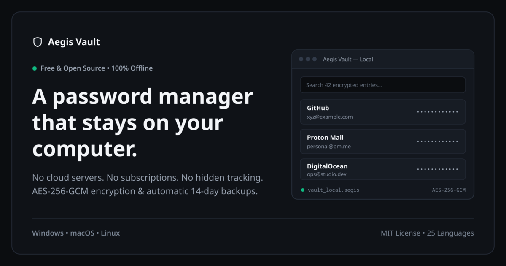

<div align="center">
  

  <h1>Aegis Vault</h1>

  <p><strong>Windows, macOS ve Linux için %100 yerel, iki katmanlı sıfır-bilgi (zero-knowledge) şifre yöneticisi.</strong></p>

  <p>
    <a href="https://aegis-vault-web.onrender.com">Web Sitesi</a> &middot;
    <a href="https://github.com/DrXendria/Aegis/releases/latest">Sürümler</a> &middot;
    <a href="#kurulum">Kurulum</a> &middot;
    <a href="#güvenlik-mimarisi">Güvenlik</a> &middot;
    <a href="#kaynaktan-derleme">Derleme</a>
  </p>

  <p>
    <a href="README.md">English</a> &middot;
    <a href="README.tr.md"><strong>Türkçe</strong></a>
  </p>

  <p>
    <a href="https://github.com/DrXendria/Aegis/releases/latest"></a>
    <a href="https://github.com/DrXendria/Aegis/releases"></a>
    <a href="LICENSE"></a>
    
  </p>

  <br />

  
</div>

---

## Genel Bakış

Aegis Vault, açık kaynaklı ve tamamen çevrimdışı çalışan bir masaüstü şifre yöneticisidir. **Bulut veritabanı, abonelik, telemetri veya internet bağımlılığı yoktur.** Şifreler, kredi kartları, abonelikler ve güvenli notlar diskte `AES-256-GCM` ve `PBKDF2-SHA256` (600.000 tur) ile şifrelenir; çökme korumalı atomik kayıt ve 14 günlük otomatik şifreli yedekleme ile korunur.

---

## Kurulum

### Paket Yöneticileri

**macOS (Homebrew)**
```bash
brew install --cask drxendria/tap/aegis-vault
```

**Ubuntu / Debian / Linux Mint (APT)**
```bash
echo "deb [trusted=yes] https://drxendria.github.io/Aegis/apt ./" | sudo tee /etc/apt/sources.list.d/aegis.list
sudo apt update && sudo apt install aegis
```

**Fedora / RHEL / Rocky (DNF / YUM)**
```bash
sudo curl -fsSL https://drxendria.github.io/Aegis/rpm/aegis.repo -o /etc/yum.repos.d/aegis.repo
sudo dnf install aegis
```

**openSUSE (Zypper)**
```bash
sudo zypper addrepo -f https://drxendria.github.io/Aegis/rpm/ aegis-vault
sudo zypper install aegis
```

**Windows (Scoop)**
```powershell
scoop bucket add drxendria https://github.com/DrXendria/scoop-bucket
scoop install aegis-vault
```

**Windows (Winget — [PR #489590](https://github.com/microsoft/winget-pkgs/pull/489590) onay sürecinde)**
```powershell
winget install DrXendria.Aegis
```

### Doğrudan İndirme (`v0.2.2`)

| Platform | Paket | İndirme |
| :--- | :--- | :--- |
| Windows (x64) | NSIS Kurulum (`.exe`) | [Aegis_0.2.2_x64-setup.exe](https://github.com/DrXendria/Aegis/releases/download/v0.2.2/Aegis_0.2.2_x64-setup.exe) |
| Windows (x64) | MSI Paketi (`.msi`) | [Aegis_0.2.2_x64_en-US.msi](https://github.com/DrXendria/Aegis/releases/download/v0.2.2/Aegis_0.2.2_x64_en-US.msi) |
| macOS (Apple Silicon) | Disk Kalıbı (`.dmg`) | [Aegis_0.2.2_aarch64.dmg](https://github.com/DrXendria/Aegis/releases/download/v0.2.2/Aegis_0.2.2_aarch64.dmg) |
| Linux (Evrensel) | Taşınabilir (`.AppImage`) | [Aegis_0.2.2_amd64.AppImage](https://github.com/DrXendria/Aegis/releases/download/v0.2.2/Aegis_0.2.2_amd64.AppImage) |
| Linux (Debian / Ubuntu / Mint) | Debian Paketi (`.deb`) | [Aegis_0.2.2_amd64.deb](https://github.com/DrXendria/Aegis/releases/download/v0.2.2/Aegis_0.2.2_amd64.deb) |
| Linux (Fedora / RHEL / openSUSE) | RPM Paketi (`.rpm`) | [Aegis-0.2.2-1.x86_64.rpm](https://github.com/DrXendria/Aegis/releases/download/v0.2.2/Aegis-0.2.2-1.x86_64.rpm) |

> [!NOTE]
> **İlk kurulum notu:** macOS'te `Aegis.app` üzerine sağ tıklayıp **Aç** deyin (veya `xattr -cr /Applications/Aegis.app` çalıştırın). Windows'ta SmartScreen uyarısı çıkarsa **Ek bilgi → Yine de çalıştır** seçeneğine tıklayın.

---

## Güvenlik Mimarisi

Aegis Vault %100 yereldir. Hiçbir şifre, meta veri veya kullanım bilgisi cihazınızdan dışarı çıkmaz.

```mermaid
sequenceDiagram
    autonumber
    actor Kullanici as Kullanıcı
    participant App as Aegis Masaüstü
    participant Crypto as Web Crypto (PBKDF2 + AES-GCM)
    participant Disk as Yerel Disk (.aegis / .bak)

    Kullanici->>App: 1. Katman - Yerel Hesap Bilgileri
    App->>Crypto: PBKDF2-SHA256 (600.000 tur + 128-bit salt)
    Crypto-->>App: accounts.json üzerinde sabit zamanlı doğrulama

    Kullanici->>App: 2. Katman - Ana Şifre (Master Password)
    App->>Crypto: PBKDF2-SHA256 (600.000 tur) -> 256-bit AES-GCM anahtarı
    App->>Disk: vault_<id>.aegis oku (bozulma varsa .bak kurtarma)
    App->>Crypto: keyCheck doğrulaması ve bellekte çözme
    Crypto-->>App: Kasa açıldı (şifreler gösterilene kadar maskeli)

    rect rgb(15, 23, 42)
        Note right of App: Çökme Korumalı Atomik Yazma
        App->>Crypto: Tüm kaydı + 96-bit rastgele IV ile şifrele
        Crypto-->>App: { v: 2, ciphertext, iv, updatedAt }
        App->>Disk: Mevcut dosyayı .bak yap, .tmp yaz -> atomik rename
    end

    Note over Disk: Her 14 günde bir otomatik şifreli yedek<br/>Documents/Aegis-Backups/aegis-auto-backup-YYYY-MM-DD.json
```



### Kriptografik Garantiler

1. **İki Katmanlı İzolasyon:** Yerel profil doğrulaması (`accounts.json`, 600.000 tur PBKDF2-SHA256) ile kasa şifrelemesi (Ana Şifre → 256-bit AES-GCM) birbirinden ayrıdır. Tek bilgisayarda birden fazla izole profil desteklenir.
2. **Tam Kayıt Şifreleme:** Site adları, kullanıcı adları, şifreler, kart numaraları, CVV ve notlar her kayıt için benzersiz 96-bit rastgele IV ile birlikte şifrelenir.
3. **Anında Anahtar Doğrulaması:** Şifreli `keyCheck` bloğu yanlış Ana Şifre girildiğinde kasayı açmadan anında reddeder.
4. **Atomik Kayıt ve Kurtarma:** Her değişiklikte önceki sağlam kasa `.bak` olarak kopyalanır, yeni veri `.tmp` dosyasına yazılıp atomik şekilde değiştirilir.
5. **Otomatik 14 Günlük Yedek:** Her iki haftada bir (ve istenilen anda) `Documents/Aegis-Backups/` klasörüne şifreli yedek kaydedilir.
6. **Pano Temizliği:** Kopyalanan şifreler 30 saniye sonra panodan otomatik olarak silinir.

---

## Özellikler

- **Tasarım Gereği Çevrimdışı:** Bulut sunucusu, API anahtarı veya ele geçirilecek hesap yok. Çoklu cihaz senkronu isterseniz şifreli `.aegis` dosyanızı Syncthing, Nextcloud veya USB ile kendiniz taşıyabilirsiniz.
- **Tek Tıkla Geçiş:** Google Chrome (`.csv`), Bitwarden (`.csv` / `.json`), LastPass (`.csv`) ve önceki Aegis v2 şifreli yedeklerinden (`.json`) doğrudan içe aktarma.
- **Şifre Sağlığı:** Dahili kriptografik şifre üretici ve 90+ gündür yenilenmeyen şifreler için otomatik hatırlatma.
- **Kartlar, Notlar & Abonelikler:** Maskeli kart bilgileri, şifreli notlar ve 18 para biriminde abonelik takibi.
- **25 Dil Desteği:** Kalıcı dil seçimi ve sağdan sola (RTL) desteği ile tam yerelleştirme.

---

## Desteklenen Diller

| | | | | |
| :--- | :--- | :--- | :--- | :--- |
| English (`en`) | Türkçe (`tr`) | Deutsch (`de`) | Español (`es`) | Français (`fr`) |
| Italiano (`it`) | Português (`pt`) | Русский (`ru`) | 中文 (`zh`) | हिन्दी (`hi`) |
| 한국어 (`ko`) | 日本語 (`ja`) | العربية (`ar`) | فارسی (`fa`) | Ελληνικά (`el`) |
| עברית (`he`) | Dansk (`da`) | Norsk (`no`) | Svenska (`sv`) | Suomi (`fi`) |
| Nederlands (`nl`) | Polski (`pl`) | Bahasa Indonesia (`id`) | Українська (`uk`) | Filipino (`fil`) |

---

## Kaynaktan Derleme

Herhangi bir `.env` dosyası veya harici sunucu gerekmez.

**Gereksinimler:** Node.js 18+, Rust & Cargo, Git.

```bash
git clone https://github.com/DrXendria/Aegis.git
cd Aegis
npm install

# Geliştirme modu
npm run tauri dev

# Üretim yükleyicileri (çıktı: src-tauri/target/release/bundle/)
npm run tauri build
```

---

## Karşılaştırma

| Özellik | Aegis Vault | 1Password | Bitwarden | LastPass |
| :--- | :---: | :---: | :---: | :---: |
| Şifreleme | `AES-256-GCM` | `AES-256-GCM` | `AES-256-CBC` | Kapalı Kaynak |
| %100 Yerel / Çevrimdışı | Evet | Hayır | Sadece Self-Host | Hayır |
| PBKDF2 Turu | `600.000` | `650.000` | `600.000` | `100.100` |
| Otomatik Yerel Yedek | Dahili (14g) | Hayır | Hayır | Hayır |
| Abonelik Takibi | Dahili (18 kur) | Hayır | Hayır | Hayır |
| Açık Kaynak | MIT | Hayır | GPL-3.0 | Hayır |
| Dil Desteği | 25 | 12 | 16 | 8 |
| Fiyat | Ücretsiz | \$35.88 / yıl | \$10.00 / yıl | \$36.00 / yıl |

---

## Lisans

[DrXendria](https://github.com/DrXendria) tarafından [MIT Lisansı](LICENSE) altında yayınlanmıştır.
Hata bildirimleri ve pull request'ler her zaman açıktır.
